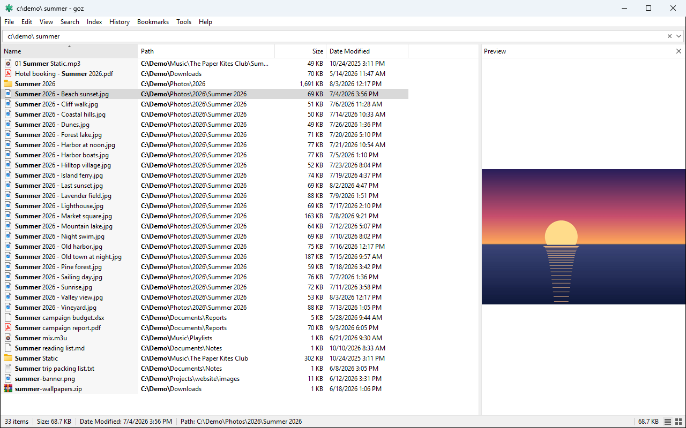
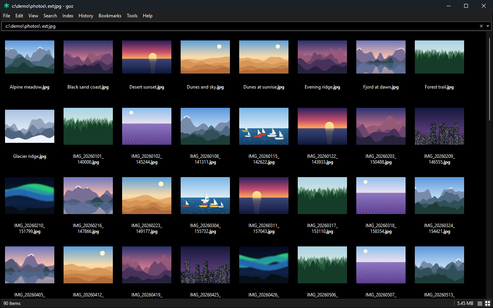
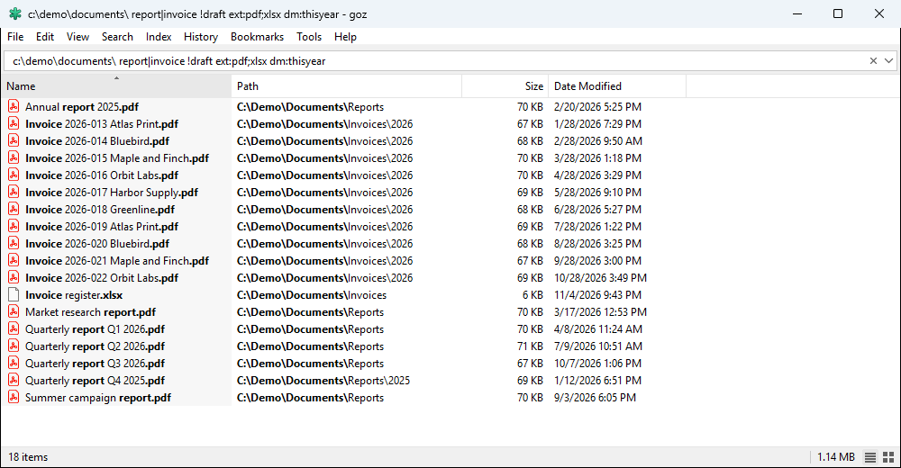
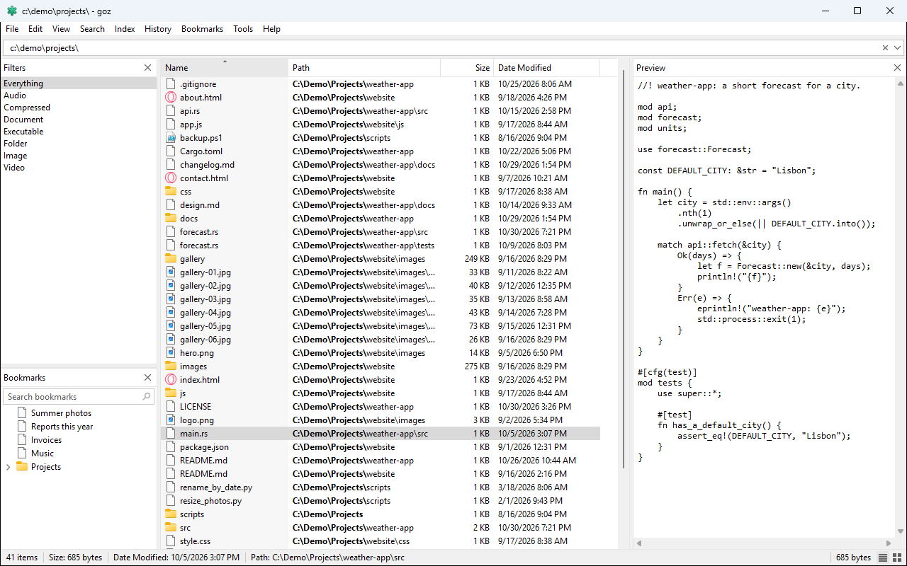
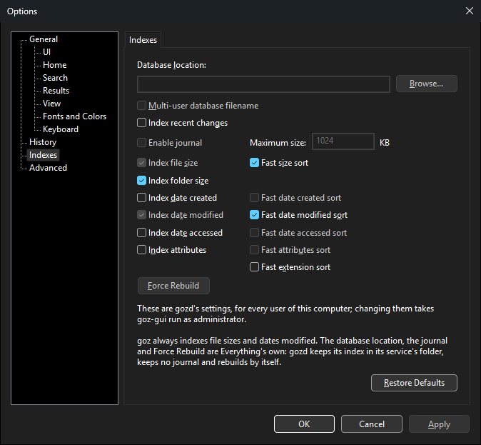

<div align="center">


# goz-gui

**Everything-style desktop search for Windows, powered by [goz](https://github.com/mustafaahci/goz).**

[](https://github.com/mustafaahci/goz-gui/actions/workflows/ci.yml)
[](LICENSE)
[](#requirements)
[](Cargo.toml)

</div>

goz-gui is a native Windows front end for **goz**, the open-source instant file search engine for NTFS. Type a few letters and every matching file and folder appears as you type, in a window that looks, works and keeps its settings like voidtools Everything 1.5.

<picture>
  <source media="(prefers-color-scheme: dark)" srcset="docs/images/hero-dark.png">
  <source media="(prefers-color-scheme: light)" srcset="docs/images/hero-light.png">
  
</picture>

## Highlights

- **Instant.** gozd answers from its in-memory index while you type. Results go into a virtual list that fetches rows 1,024 at a time, so a million matches scroll as smoothly, and cost as little memory, as ten.
- **Native and small.** Plain Win32 and the common controls in Rust: no UI framework, no web view, no runtime to install. One exe of about 5 MB that idles at about 6 MB of private memory.
- **Everything 1.5's search syntax.** Wildcards, path terms, `ext:`, `size:`, `dm:` and, with gozd v0.7.0, OR (`a|b`), NOT (`!draft`), groups, modifiers and macros. `content:` searches inside files, read by goz-gui under your own account.
- **Everything's window.** Tabs and windows, Folders, Filters and Bookmarks sidebars, a Preview pane (pictures, text and Windows' preview handlers), thumbnail views, Explorer's context menu, Advanced Rename with undo, and Everything file lists (`.efu`) with an editor.
- **Live.** New, changed and deleted files appear without searching again, and the scroll position and selection stay. gozd v0.7.0 says when something changed; with an older gozd the results refresh every 2 seconds.
- **Keyboard-first.** Everything's shortcuts, each one rebindable in Options → Keyboard, plus global hotkeys, a tray icon, a taskbar jump list and `goz:` links.
- **At home on Windows 11.** Follows the system's light or dark theme down to the title bar, menus and scroll bars, scales per monitor, lets you choose the fonts and colours of every part, and tells screen readers about the parts it draws itself.
- **Reads Everything's files.** Settings use Everything 1.5's INI keys, and its `Bookmarks.csv`, `Filters.csv`, `Search History.csv`, `Run History.csv` and `Session.json` can be imported or copied over.

## Screenshots

<table>
  <tr>
    <td width="50%" valign="top">
      <a href="docs/images/thumbnails.png"></a>
      <br><sub>Large thumbnails: <code>c:\demo\photos\ ext:jpg</code> as a grid of 90 photos.</sub>
    </td>
    <td width="50%" valign="top">
      <a href="docs/images/syntax.png"></a>
      <br><sub>Everything 1.5's syntax: <code>report|invoice !draft ext:pdf;xlsx dm:thisyear</code>, with OR, NOT, <code>ext:</code> and <code>dm:</code>.</sub>
    </td>
  </tr>
  <tr>
    <td width="50%" valign="top">
      <a href="docs/images/sidebars.png"></a>
      <br><sub>Filters and Bookmarks sidebars, and the text preview of a source file.</sub>
    </td>
    <td width="50%" valign="top">
      <a href="docs/images/options.png"></a>
      <br><sub>Options → Indexes: gozd's index options, read from and applied to gozd.</sub>
    </td>
  </tr>
</table>

## Requirements

- Windows 10 or 11, 64-bit.
- **gozd**, goz's search service, installed and running. Download `goz.exe` and `gozd.exe` from the [latest goz release](https://github.com/mustafaahci/goz/releases/latest) and run `gozd.exe install` in an elevated terminal: it registers gozd as an auto-start Windows service and starts it.

gozd v0.7.0 or newer is recommended. It adds change notifications, folder sizes, sorting by Date Created, Date Accessed, Attributes and Date Recently Changed, Options → Indexes, and Everything 1.5's OR, NOT and groups. goz-gui asks gozd what it supports, so with gozd v0.6.0 everything else works as before.

## Install

Download one of these from the [latest goz-gui release](https://github.com/mustafaahci/goz-gui/releases/latest):

- **Installer (recommended):** `goz-gui-vX.Y.Z-x64.msi`. It installs for the current user only, with no administrator prompt, to `%LocalAppData%\Programs\goz-gui`, and adds goz-gui to the Start menu and to Settings → Apps → Installed apps, where you can uninstall it. A newer MSI upgrades an older one in place. Silent install: `msiexec /i goz-gui-vX.Y.Z-x64.msi /qn`.
- **Portable:** `goz-gui-vX.Y.Z-windows-x86_64.zip`. Unzip it anywhere and run `goz-gui.exe`. Settings go to `%APPDATA%\goz-gui`; to keep them next to the exe instead, put a `goz-gui.ini` containing `app_data=0` beside it.

`SHA256SUMS.txt` lists the checksums; compare them with `Get-FileHash <file>` in PowerShell.

> [!NOTE]
> goz-gui is not code-signed yet, so the first time you open the MSI or the exe, Windows may say "Windows protected your PC". Choose **More info → Run anyway**. The MSI gets the same warning as the exe; only code signing avoids it. For the zip, you can instead right-click it → Properties → **Unblock** before extracting.

Close goz-gui (File → Exit, or Exit in the tray menu) before you upgrade or uninstall. Uninstalling keeps your settings in `%APPDATA%\goz-gui` and whatever you turned on in Options → General (start with Windows, the Explorer folder item, `goz:` links, the `.efu` association, the desktop shortcut), so turn those off first if you want them gone.

## Quick start

Start goz-gui and type: the results follow every keystroke. Words must all appear in the name, in any order and any case. A few keys to start with (the full list is in [Keyboard shortcuts](docs/KEYBOARD.md)):

| Key | Action |
| --- | --- |
| Up / Down | Move through the results without leaving the search box |
| Enter | Open the selected result (from the search box, the first Enter selects the result you open most often) |
| Ctrl+Enter | Open the containing folder with the item selected |
| Ctrl+Shift+C | Copy the full path |
| F2 | Rename in place (Advanced Rename when several rows are selected) |
| Ctrl+T / Ctrl+W | New tab / close the tab |
| Alt+P | Show or hide the Preview pane |
| Ctrl+Shift+2 / Ctrl+Shift+6 | Large thumbnails / back to details |
| Ctrl+D | Bookmark the search |
| Ctrl+P | Options |

Some searches to try:

| Search | Finds |
| --- | --- |
| `report ext:pdf;docx` | PDF and Word files with "report" in the name |
| `C:\Projects\ *.rs` | Rust source files anywhere under `C:\Projects` |
| `size:>100mb dm:thisyear` | Files over 100 MB modified this year |
| `invoice\|receipt !draft` | Invoices or receipts, but no drafts (gozd v0.7.0 or newer) |
| `*.txt content:"to do"` | Text files that contain "to do" (read by goz-gui, not by gozd) |

Help → Search Syntax lists everything the search box accepts; goz's README has the [full syntax](https://github.com/mustafaahci/goz#search-syntax).

## How it works

goz-gui talks to gozd over its named pipe with goz's own protocol crates, after checking that the pipe belongs to the elevated goz service. It asks gozd only for what gozd lists in its greeting, so one goz-gui works with gozd v0.6.0 and v0.7.0 alike. gozd indexes file names, sizes and dates, never contents: `content:` searches are read by goz-gui itself, under your own account. More in the [feature reference](docs/FEATURES.md#how-it-works).

## Documentation

- [Feature reference](docs/FEATURES.md): every menu, pane, dialog, option and settings file, in detail.
- [Keyboard shortcuts](docs/KEYBOARD.md): all the default keys.
- [Building](docs/BUILDING.md): building from source, the MSI installer and releases.
- [Testing](docs/TESTING.md): the checks, and the test hooks that keep a build under test away from your own files and settings.
- [Changelog](CHANGELOG.md)

## Building from source

You need Rust 1.94 or newer with the MSVC toolchain (the Visual Studio Build Tools' C++ linker).

```
git clone https://github.com/mustafaahci/goz-gui
cd goz-gui
cargo build --release
```

This produces `target\release\goz-gui.exe`, a single exe with the C runtime linked in. To build the MSI as well, see [docs/BUILDING.md](docs/BUILDING.md).

## Contributing

Issues and pull requests are welcome. Before you open a pull request, run the checks CI runs:

```
cargo fmt --check
cargo clippy --locked --all-targets -- -D warnings
cargo test --locked
```

When you try a change by hand, point `GOZ_GUI_DATA_DIR` and `GOZ_GUI_REG_ROOT` at test locations so the build you are testing leaves your own settings and registry alone; [docs/TESTING.md](docs/TESTING.md) lists every test hook.

## License

Licensed under the [MIT License](LICENSE).

goz-gui is an independent project and is not affiliated with voidtools. Everything is a product of voidtools.
